Connect Greenhouse Recruiting so you don't have to re-enter candidate and offer details. When an offer is created or updated in Greenhouse, ClearOffer creates an unpublished offer that you can review, complete, and share with the candidate.

<Info>
The connection only reads data from Greenhouse. ClearOffer doesn't add or change candidates, jobs, offers, or custom fields there. The only things it creates in your Greenhouse account are its own two webhooks.
</Info>

## Before you start

- A ClearOffer user with the **Admin** role
- A Greenhouse user with **Site Admin** permissions
- A Greenhouse plan that includes Harvest v3 partner integrations. See Greenhouse's article, [Connect to Harvest v3 partner integrations](https://support.greenhouse.io/hc/en-us/articles/41437121183899-Connect-to-Harvest-v3-partner-integrations)

## Connect Greenhouse

<Steps>
<Step title="Open Integrations">
In ClearOffer, click `Company` in the sidebar, then click `Integrations`.
</Step>

<Step title="Start the connection">
On the Greenhouse card, click `Connect with Greenhouse`. ClearOffer sends you to Greenhouse to approve the connection.

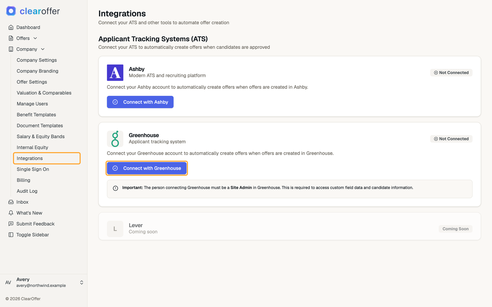
</Step>

<Step title="Authorize ClearOffer">
Enter your Greenhouse email address and click `Log in to Greenhouse`. Review the permissions, select `Authorize using a service account`, then click `Authorize`.

<Tip>
We recommend a service account. The connection then belongs to your organization rather than to one person, so it isn't tied to an individual user's account.
</Tip>

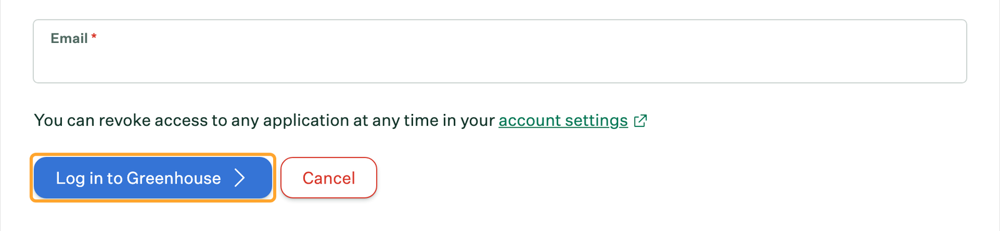

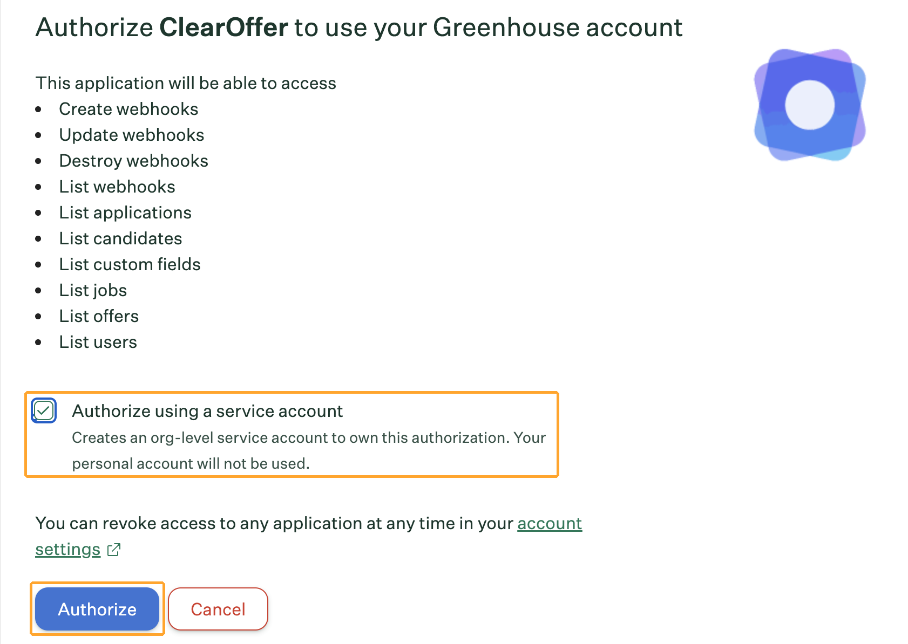
</Step>

<Step title="Check the connection">
Greenhouse sends you back to ClearOffer. The Greenhouse card now shows a `Connected` badge.

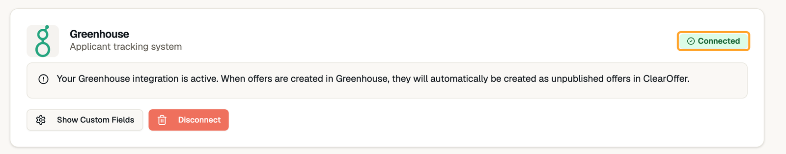

<Warning>
If you see `Greenhouse Connected with Warnings`, no webhooks were created and offers won't sync. If only one webhook fails, the `Greenhouse Connected` message says so. See [Offers aren't appearing](#offers-arent-appearing).
</Warning>
</Step>
</Steps>

ClearOffer creates two webhooks in Greenhouse for you, so there's nothing to set up by hand. To see them, click the **Configure** icon in Greenhouse, then click **Dev Center**. Click **Webhooks**, then click **Webhooks** again. They're listed under **Edit Webhook**.

| Webhook name | When it fires |
|---|---|
| `ClearOffer - offer_created` | An offer is created |
| `ClearOffer - offer_updated` | An offer is updated |

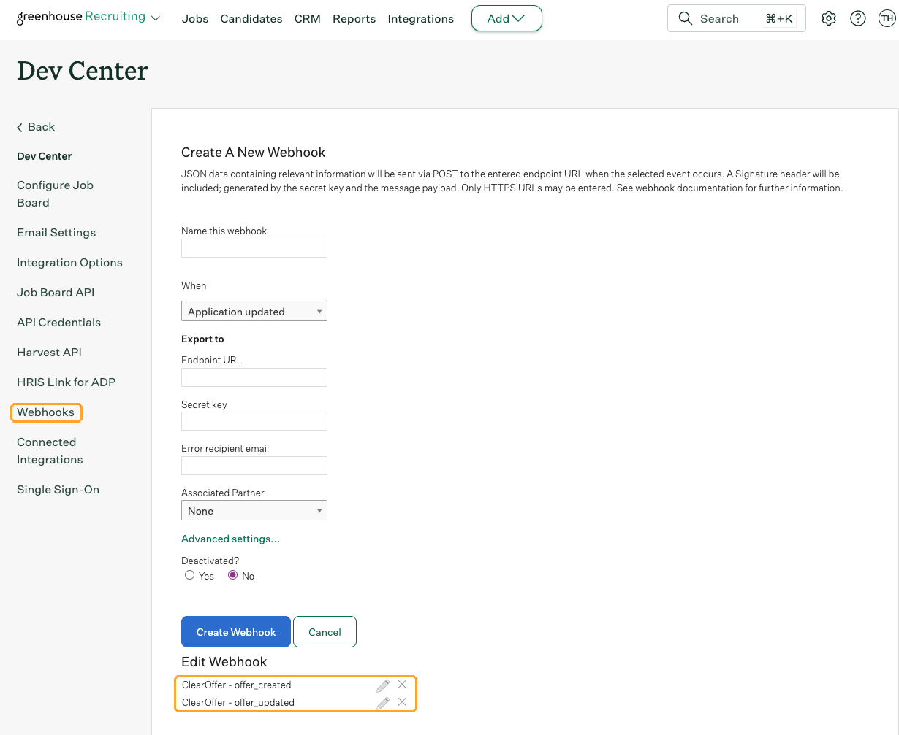

## What happens when an offer syncs

<Steps>
<Step title="An offer is created in Greenhouse">
ClearOffer creates an offer with the `Unpublished` status. The candidate can't see it yet. Synced offers look the same as offers created in ClearOffer.

ClearOffer creates the offer as soon as Greenhouse reports it, whether or not the offer has been approved in Greenhouse.

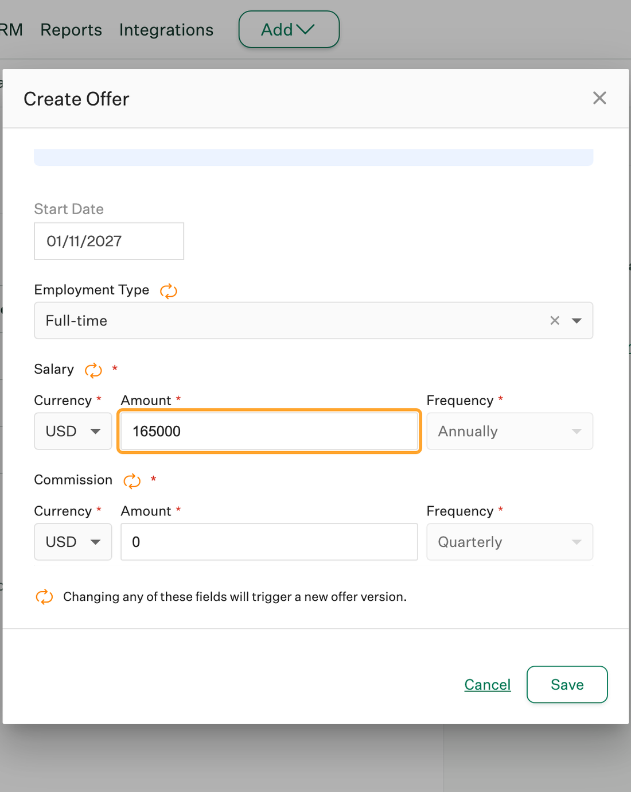

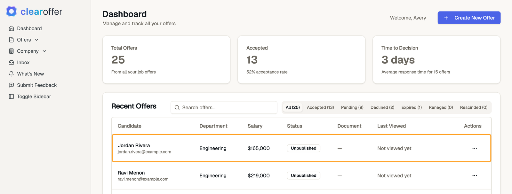
</Step>

<Step title="Review and complete it">
On the Dashboard, click the `...` menu on the offer and then `View Details`. Click `Edit Offer` to check the details. Add anything Greenhouse doesn't provide, such as benefits, bonuses, and documents.

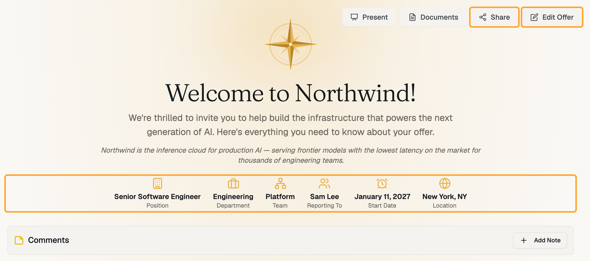

<Warning>
Always review an offer before you share it. If ClearOffer can't get a value from Greenhouse, it uses a placeholder or a default. Look for a role of `New Hire`, a salary of `$0`, a candidate named `Greenhouse Candidate`, or an email address ending in `temp.clearoffer.io`. Equity values that don't come from Greenhouse also use defaults, so check them closely.
</Warning>
</Step>

<Step title="Share it with the candidate">
On the offer page, click `Share`. From the Dashboard, you can also click the `...` menu and then `Generate Shareable Link`. Creating the link publishes the offer. Copy the link and send it to your candidate.

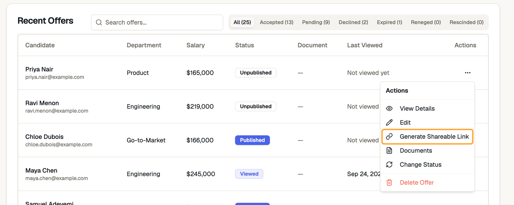
</Step>
</Steps>

## When an offer changes in Greenhouse

| Change in Greenhouse | ClearOffer offer status | What happens in ClearOffer |
|---|---|---|
| Any update | `Unpublished` | The offer updates automatically |
| Any update | `Published` or `Viewed` | The offer updates and its status stays the same. The candidate sees the new details at the same link. If the change affects a generated offer letter document, the candidate can't view or sign it until you generate a new link |
| Edit to the same offer version | `Accepted`, `Declined`, or another closed status | The offer updates and its status stays the same |
| New version of the offer | `Accepted`, `Declined`, or another closed status | ClearOffer creates a new `Unpublished` offer. Review and share it. The original offer doesn't change |

Greenhouse marks the offer fields that create a new version with a cycle icon on the offer form, and shows the note `Changing any of these fields will trigger a new offer version`. Salary is one of them. Start date isn't.

A few things to keep in mind:

- **Greenhouse wins for synced fields.** Each update replaces the role, department, location, reporting manager, salary, currency, and candidate name and email in ClearOffer, including edits you made there. A blank value in Greenhouse replaces what's in ClearOffer too, and a missing salary becomes `$0`. Make lasting changes in Greenhouse.
- **Other details stay as they are.** Updates don't change the offer's status, expiration date, pay frequency, bonuses, benefits, commission, or documents.
- **A candidate's unpublished offer gets reused.** If a candidate already has an unpublished offer in ClearOffer, a new Greenhouse offer for that candidate updates it rather than creating a second one, even if you created it by hand.
- **Changing a candidate's email breaks the shared link.** If the email changes in Greenhouse, the earlier link stops working. Generate a new link and send it to the candidate.
- **Failed lookups can affect shared offers.** If ClearOffer can't reach Greenhouse during an update, the placeholders described above can replace details on an offer that's already been shared. If that happens, correct the offer and contact support.

## What gets synced

| In Greenhouse | In ClearOffer |
|---|---|
| Candidate first and last name | First Name and Last Name |
| Candidate's first listed email address | Candidate Email |
| Job name | Role |
| Offer start date | Start Date |
| Salary custom field amount | Base Salary |
| Salary custom field currency | Currency |
| Offer custom field with the key `location` | Location |
| Offer custom field with the key `department` | Department |
| User who created the offer, matched by email address | The recruiter on the offer |

<Note>
Salary comes from an offer custom field with a **Currency** value. The field must be marked as base compensation in Greenhouse, or have "salary" in its field key. If your salary field is a plain number, map it to `Base Salary Override` instead. Otherwise, the offer comes through with a $0 salary.
</Note>

ClearOffer fills in the rest from your company settings or its standard defaults. That includes the welcome message, offer expiration, and any equity pricing. Pay frequency and employment type use your company defaults, or biweekly and full-time if you haven't set them. Any field with a default in ClearOffer keeps using it unless it's set on your offer in Greenhouse.

## Map custom fields

Map your Greenhouse offer custom fields to fill in more of each offer, such as team, reporting manager, or equity.

<Steps>
<Step title="Open custom fields">
On the connected Greenhouse card, click `Show Custom Fields`. ClearOffer loads your active fields from Greenhouse. To reload them later, click `Sync Fields from Greenhouse`.

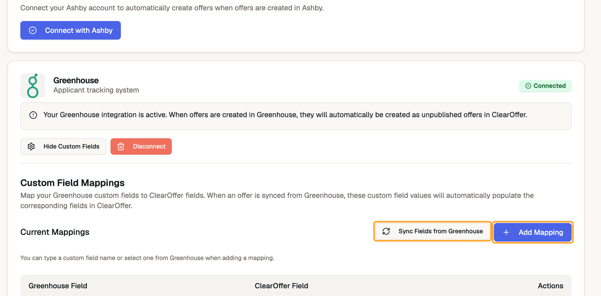
</Step>

<Step title="Add a mapping">
Click `Add Mapping`. Choose or type the Greenhouse field, choose a ClearOffer field, then click `Save`.

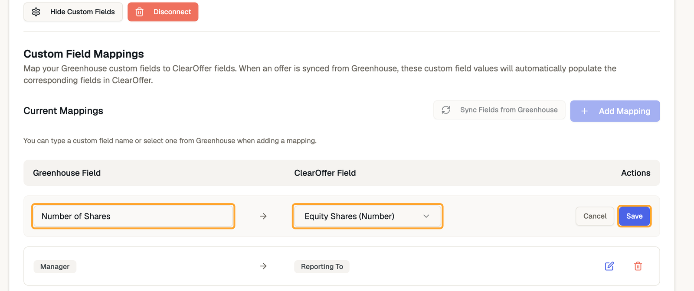
</Step>

<Step title="Test it">
Mappings apply the next time Greenhouse sends an offer. Create or update a test offer in Greenhouse and check the result in ClearOffer.
</Step>
</Steps>

### Fields you can map

| ClearOffer field | What to know |
|---|---|
| Job Title/Role | Replaces the job name |
| Department | Replaces the value from the `department` custom field |
| Team | An empty text value clears the team. A missing value leaves it unchanged |
| Location | Replaces the value from the `location` custom field |
| Reporting To | Works with text fields and user fields |
| Base Salary Override | Must be a number, and replaces the salary amount |
| Employment Type | Use a value such as `Full-time`, `Part-time`, or `Contractor` |
| Welcome Message | Replaces your company's default message |
| Equity Shares (Number) | The number of shares, not a dollar amount |
| Equity Type | Use `stock_options` or `rsus`. Only applies when Equity Shares is also mapped |

<Warning>
The dropdown also lists Candidate First Name, Candidate Last Name, Candidate Phone Number, Currency, Payment Frequency, Start Date, Expiration Date, Years Vesting, and Cliff Period (Months). Mappings to these fields aren't applied to synced offers right now, so set these values in ClearOffer. Candidate names, start date, and currency still sync automatically from Greenhouse, so the next update can overwrite those values.
</Warning>

## Disconnect Greenhouse

<Steps>
<Step title="Disconnect in ClearOffer">
Go to `Company` > `Integrations`, click `Disconnect` on the Greenhouse card, then confirm. ClearOffer removes its webhooks from Greenhouse.
</Step>

<Step title="Check for leftover webhooks">
In Greenhouse, go to **Configure** > **Dev Center** > **Webhooks** > **Webhooks** and delete any ClearOffer webhooks that are still listed.
</Step>

<Step title="Revoke access in Greenhouse (optional)">
Disconnecting in ClearOffer doesn't remove the authorization from Greenhouse, and each new connection adds another entry there. To remove them, go to **Configure** > **Dev Center** > **Connected Integrations**, then disconnect ClearOffer.
</Step>
</Steps>

Your existing ClearOffer offers aren't deleted, and new Greenhouse offers stop syncing. Your custom field mappings are kept and apply again if you reconnect.

## Troubleshooting

<AccordionGroup>
<Accordion title="Offers aren't appearing">
- Make sure the candidate has an offer in Greenhouse. ClearOffer only reacts to offers, not to other candidate activity
- In Greenhouse, go to **Configure** > **Dev Center** > **Webhooks** > **Webhooks** and confirm both ClearOffer webhooks are listed
- In the same section, open **Webhook Log** to see whether Greenhouse delivered the offer to ClearOffer
- If a webhook is missing, disconnect in ClearOffer, delete any ClearOffer webhooks left in Greenhouse, and connect again

The `Connected` badge means ClearOffer holds a Greenhouse authorization. It doesn't confirm that offers are syncing, and ClearOffer doesn't send a notification when a sync fails. If you can't find the problem, email [support@clearoffer.io](mailto:support@clearoffer.io) with the candidate's name and the time the offer was changed.
</Accordion>

<Accordion title="An offer has placeholder details">
If an offer shows `New Hire`, a `$0` salary, or an email address ending in `temp.clearoffer.io`, ClearOffer couldn't get that data from Greenhouse. Check that the person who authorized the connection was a Site Admin. Then correct the offer in ClearOffer, and contact support if it keeps happening.
</Accordion>

<Accordion title="A custom field isn't in the list">
- Click `Sync Fields from Greenhouse` to refresh the list
- Confirm the field is active in Greenhouse
- Type the field name yourself. The name doesn't have to come from the list

The list can include other types of custom fields, but only offer custom fields are applied.
</Accordion>

<Accordion title="A mapping didn't apply">
- Confirm the field is an offer custom field, and that its name matches Greenhouse
- Confirm you're using one of the [fields you can map](#fields-you-can-map)
- Update the offer in Greenhouse after saving the mapping, because mappings don't apply retroactively
</Accordion>

<Accordion title="Do I need a Harvest API key?">
No. ClearOffer connects through Greenhouse's OAuth authorization. You don't need to create or share an API key.
</Accordion>
</AccordionGroup>

## Get help

Email [support@clearoffer.io](mailto:support@clearoffer.io).
